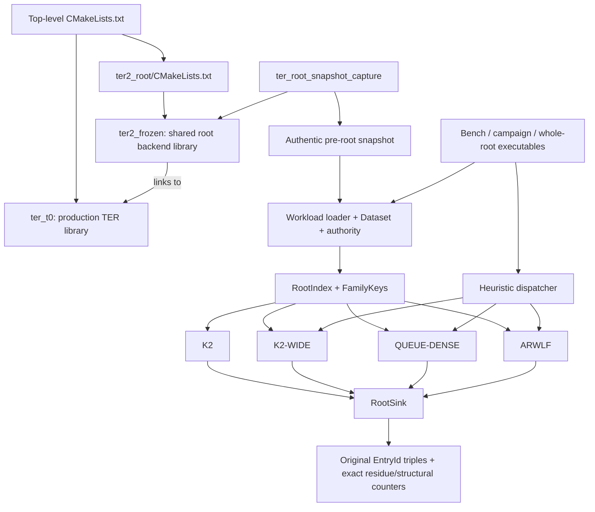
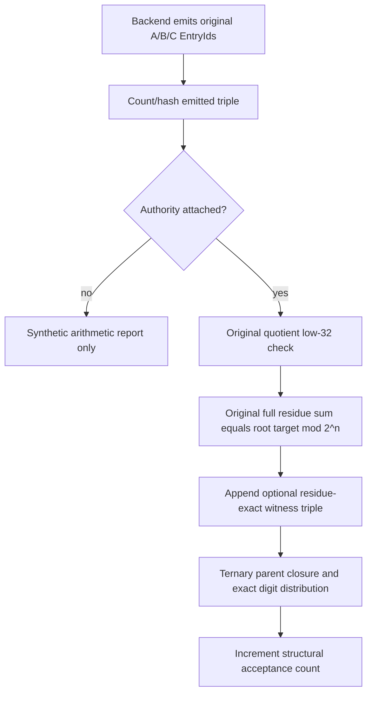

# TER² root architectures: ARWLF, QUEUE-DENSE, K2 and K2-WIDE

Source-first dossier of the code that builds and executes these four backends.

| Provenance | Value |
|---|---|
| Repository inspected | `C:\Users\naman\Desktop\subset-sum-ter-fft` |
| Inspection date | 2026-10-03 |
| Local HEAD | `8e9fe7fdda447088738b5e682ba6aea4cf83a121`, branch `main` |
| Source basis | Local checkout, including existing uncommitted campaign/whole-root work; not just GitHub HEAD |
| Frozen core | 29 files; the repository's CR-normalized SHA-256 manifest check passed during this inspection |
| Scope | Runtime/build wiring, arithmetic, data ownership, kernels, output recovery, dispatch, limits and measurement boundaries |
| Excluded | Test catalogue, retired experiment catalogue and unrelated project machinery |
| Execution during this documentation task | Read-only source/artifact inspection and frozen-manifest check; no build, test or benchmark run |

The existing dirty worktree was preserved. In particular, the whole-root runner described below is present locally but was untracked at inspection. Its CMake wiring and several campaign files also have local modifications. This dossier documents that state, not a claim that all described files belong to the named commit.

The existing `.gitignore` rule `*.md` ignores this new dossier. That rule was not changed, and the file was not staged.

## 1. The main conclusion

These are four **TER² L1→L0 root-reporting backends**, sharing prepared inputs and exact downstream authorities. They are not four complete TER solvers.

| Backend | Main operation | Width checked before shared sink | Main strength | Main limitation |
|---|---|---|---|---|
| K2 | Sweep 8×8 Q/X tiles; coarse SIMD membership, exact bitmap recovery | Low 25 quotient bits | Simple reference reporter; small-workload baseline | Large low-25 survivor flood is handed to scalar authority/output work |
| K2-WIDE | Same K2 sweep, then full quotient equality before emission | Full supported Q, including bits above 64 | Avoids sending low-width false candidates into the sink | Still performs the K2 pair sweep and visits Y postings in surviving residual groups |
| QUEUE-DENSE | Translated position occupancy, compact queue of nonzero words, exact dense-tag intersection | Low 25 quotient bits | Replaces many individual X comparisons with position/tag bitset work | Fixed class/hit capacity; full-width authority still downstream |
| ARWLF | Fixed radix-13 leaves, byte-occupancy filters, AVX2 rows and exact scalar resolution | Full supported Q, including bits above 64 | Amortized leaf filtering on densely occupied authentic families | Setup cost, occupancy-dependent false positives, potentially large survivor scratch |

**Production boundary:** `solve_full_ter` still selects the existing `ternary_tiled_l1_to_l0` root path for its supported shapes, with legacy `ternary_mitm` fallback. It does not dispatch these four frozen backends. `report_full_ter_root` also uses that production tiled path. Snapshot capture exposes compatible L1 lists for isolated replay; it does not constitute production integration. See [production root selection](src/full_ter.cpp#L3406), [root reporter](src/full_ter.cpp#L3814) and [ARWLF scope declaration](ter2_root/frozen/ter_arwlf.hpp#L3).

None of these four hot paths is NTT/FFT convolution. They use SIMD sums, occupancy bitmaps, radix layout and exact recovery.

## 2. Build and runtime map



The dependency direction matters: `ter2_frozen` links **to** `ter_t0`; adding frozen backends does not make the production solver call them.

### Actual compiled library

[Top-level CMake](CMakeLists.txt#L569) includes `ter2_root`. Its [library definition](ter2_root/CMakeLists.txt#L50) compiles these source groups:

| Compiled source group under `ter2_root/frozen/` | Runtime responsibility |
|---|---|
| `ter_root_generalization_workload.cpp`, `ter_root_snapshot.cpp`, `ter_root_capture_adapter.cpp` | Capture, persistent snapshots, loading, authentic workload conversion and authority preparation |
| `ter_root_queue_kernels.cpp` | RootIndex, RootSink, K2 driver and radix/QUEUE-DENSE wrapper |
| `ter_microreport8_dataset.cpp` | Shared Dataset construction, target bitmaps and prepared donor views |
| `ter_microreport8_kernels_avx2.cpp` | K2's coarse SIMD tile kernel |
| `ter_radix13_locator.cpp`, `ter_radix13_locator_avx2.cpp` | Radix classes, shifted occupancy views and locator support |
| `ter_radix13_packed.cpp`, `ter_radix13_packed_bmi2.cpp` | Packed routing; the latter also contains the actual QUEUE-DENSE control specialization |
| `ter_translated_tag_dataset.cpp`, `ter_translated_tag_locator.cpp`, `ter_translated_tag_locator_avx2.cpp` | Donor authority and aligned/view/locator support |
| `ter_a64_chqr.cpp` | Shared full-width FamilyKeys and K2-WIDE |
| `ter_arwlf.cpp`, `ter_arwlf_avx2.cpp` | ARWLF preparation, filtering, exact resolution, guard and dispatcher |

Headers and `.inl` files included by these translation units are executable architecture too, especially `ter_microreport8_kernels.hpp`, `ter_radix13_locator.hpp` and `ter_radix13_packed_kernel.inl`.

### Executables that actually exercise the architecture

| Target | Entry source under `ter2_root/campaign/` | What it does |
|---|---|---|
| `ter_root_snapshot_capture` | `ter_root_snapshot_capture.cpp` | Run authentic pre-root construction and persist three L1 lists; does not run a root backend |
| `ter_arwlf_bench` | `ter_arwlf_bench.cpp` | Matched prepared-input comparison of named entities over selected cells |
| `ter_arwlf_campaign` | `ter_arwlf_campaign_main.cpp` + `ter_arwlf_campaign.cpp` | Geometry census, authentic/thinned/planted cases, matched protocol and result/provenance reporting |
| `ter_arwlf_whole_root` | `ter_arwlf_whole_root_main.cpp` + `ter_arwlf_whole_root.cpp` + campaign implementation | Local whole-root replay over all 4096 cells, with one constructed positive target and checkpointed results |

Targets are wired at [CMake lines 97 onward](ter2_root/CMakeLists.txt#L97); the local whole-root target is at [line 132](ter2_root/CMakeLists.txt#L132). Tests are intentionally omitted from this map.

### ISA and compilation contract

- C++20 is the project language level. `TER_NATIVE_OPT` is a project-wide native-optimization option, not a runtime backend selector.
- K2 and ARWLF SIMD translation units receive AVX2-specific compiler flags. The packed queue translation unit receives AVX2 and, on GCC-like compilers, BMI2 flags.
- The TER² targets do not enable project IPO; comments require it to remain off to prevent cross-ISA inlining. There is no explicit FALSE target property overriding an inherited/global IPO setting. Global native optimization also prevents treating the entire build as a universal portable binary.
- K2/K2-WIDE choose their SIMD kernel from the translation unit's compiled availability, **not an independent runtime CPUID check in each wrapper**. QUEUE-DENSE also calls its hardware route directly.
- Campaign and whole-root entrypoints enforce the CPU/OS contract: AVX, OSXSAVE, enabled XMM/YMM XCR0 state and AVX2. The matched `ter_arwlf_bench` entrypoint does not enforce that gate and assumes a compatible host for K2/QUEUE-DENSE. ARWLF independently checks compiled and runtime availability before using its vector path.
- QUEUE-DENSE's dense-control specialization does not require PEXT/PDEP even though it resides in a `bmi2` namespace/file. Do not describe it as the payload-deck BMI2 algorithm.

Sources: [ISA compilation](ter2_root/CMakeLists.txt#L16), [K2 kernel choice](ter2_root/frozen/ter_root_queue_kernels.cpp#L83), [ISA detector](ter2_root/frozen/ter_microreport8_kernels.hpp#L327), [dense-control route](ter2_root/frozen/ter_radix13_packed_bmi2.cpp#L194).

## 3. Shared arithmetic: what problem is being reported?

Let A, B, C be the three L1 lists, with original residues `R_A`, `R_B`, `R_C`, child targets `c_A`, `c_B`, `c_C`, root target `T`, and inherited modulus `2^r1`. Within each list, the inherited target condition permits quotient extraction.

```text
Q   = n - r1
q_L = ((R_L - c_L) mod 2^n) >> r1
tau = ((T - c_A - c_B - c_C) mod 2^n) >> r1
d_C = (tau - q_C) mod 2^Q

Root quotient condition: q_A + q_B = d_C (mod 2^Q)
```

The common donor retains a low-25 projection and splits it into a six-bit family and a nineteen-bit residual:

```text
s = q_A & 63       t = q_B & 63       u = d_C & 63
u = (s+t) & 63     kappa = (s+t) >> 6

q = (q_A >> 6) & (2^19-1)
x = (q_B >> 6) & (2^19-1)
y = (d_C >> 6) & (2^19-1)

q + x + kappa = y (mod 2^19)
```

There are 64 families per list and 4096 `(s,t)` cells. A cell determines its target family and carry. The code often calls this a microproblem. Selecting one cell is **not** evaluating a whole root.

The letter `Q` has two uses in code/prose: quotient bit width, and Q-list/row-side keys. In this dossier, `Q` in formulas is the width; “Q rows” means the prepared A-side postings.

### Full-width keys and the >64-bit case

[FamilyKeys construction](ter2_root/frozen/ter_a64_chqr.cpp#L266) accepts valid prepared snapshot workloads with `25 <= Q <= 69`:

```text
F = min(Q,64)
W = F - 6
high_width = Q - F
```

It stores the low F bits split into family and W-bit residual, plus an additional high field when Q exceeds 64. It checks family/residual alignment against each existing donor posting. FamilyKeys is an aligned representation, not a replacement authority for the original vector/residue data.

| Captured dimension | r1 | Q | F | W | High field | ARWLF mid field |
|---|---:|---:|---:|---:|---:|---:|
| n=72 campaign root | 25 | 47 | 47 | 41 | 0 bits | 28 bits |
| n=108 campaign root | 39 | 69 | 64 | 58 | 5 bits | 32 bits |

These are the captured campaign geometries, not a promise that arbitrary instances/configurations have those r1 values.

For Q=69, full equality is not truncated to 64 bits. Two W=58 residuals plus the low-family carry fit in 59 bits. K2-WIDE/ARWLF check that residual sum, then propagate `sum >> W` into the five-bit high field. Thus their full-key comparison handles this supported >64-bit quotient case without a 128-bit residual addition. Snapshot/original-residue arithmetic uses the wider limb representation independently.

Sources: [snapshot quotient derivation](ter2_root/frozen/ter_root_generalization_workload.cpp#L630), [FamilyKeys fields](ter2_root/frozen/ter_a64_chqr.hpp#L52), [wide comparison](ter2_root/frozen/ter_a64_chqr.cpp#L371).

## 4. Common data, ownership and exact output authority

### Prepared input ownership

`Workload` owns a heap-stable Dataset and optional AuthorityTables. Dataset target views borrow pointers into Dataset-owned buffers, so copying/moving pointer-bearing structures without preserving their owner would break the contract. FamilyKeys uses the same family posting order; original EntryIds remain recoverable.

| Structure | Data it retains | Why it exists |
|---|---|---|
| `mr8::Dataset` | Q/X/Y family postings, residual values, original IDs, exact/coarse target views | Shared arithmetic input for every backend |
| `RootIndex` | Equal-residual groups, posting-to-group maps, Y bitmap/rank lookup, selected-cell mask, family offsets | Recover duplicates and original IDs without losing multiplicity |
| `a64::FamilyKeys` | Family-aligned W-bit residuals and high fields | Full-Q checks without redoing original limb arithmetic for every projected candidate |
| `AuthorityTables` | Original low-32 quotients, full residue limbs, scalar ternary digits, root target and expected parent distribution | Independent downstream arithmetic and structural truth |
| `RootSink` | Borrowed input/index/authority pointers; counters and optional caller-owned output vectors | Common reporting and authority chain |

Snapshot full keys are reconstructed from the captured residues and targets, with low-prefix cross-checks against donor conversion. Not every older direct-capture helper populates the full-key arrays; use the validated snapshot loading path for these full-width backends.

[Workload ownership](ter2_root/frozen/ter_root_generalization_workload.hpp#L81), [snapshot format](ter2_root/frozen/ter_root_snapshot.hpp), [authority fields](ter2_root/frozen/ter_translated_tag_dataset.hpp#L34).

### Equal values are not equal entries

A `ResidualGroup` is a distinct residual value plus a posting span `{begin,count}`. Entries with the same projected value remain separate original IDs. The index's exact Y membership bitmap and rank calculation recover the appropriate group; the group contains every C posting with that value.

K2 emits individual Q/X posting pairs then expands matching Y postings. QUEUE-DENSE emits group relations then expands the complete Q×X×Y posting product. K2-WIDE and ARWLF resolve full-key matches before emitting original triples.

No backend deduplicates original triples or canonical parent vectors. Duplicate values and representations remain part of the workload and output cost.

### The shared authority chain



This order is literal [RootSink source](ter2_root/frozen/ter_root_queue_kernels.cpp#L165). Three terminology traps matter:

1. `digest.full_q` is the shared sink's **low-32 quotient** check. Its name does not mean full 69-bit quotient equality.
2. The optional `witnesses` vector is appended after exact residue equality but **before structural validity**. It can contain triples that do not form a valid TER parent.
3. A structural acceptance count is not a constructed, deduplicated L0 list or an independently verified final binary Subset Sum solution.

K2/QUEUE-DENSE's `digest.triples` counts exact low-25 triples. K2-WIDE/ARWLF's counts are already full-Q-filtered. Their early counters need not agree. Compare shared residue-exact output/multiplicity and structural acceptance at the same authority level instead.

`GroupOnly`, build-only controls, selected-cell runs and reduced-work probes are diagnostic scopes, not complete root outcomes. Empty output, refused applicability or an aborted run must not be reported as UNSAT.

## 5. K2: the baseline tiled SIMD reporter

Main entry: [run_k2](ter2_root/frozen/ter_root_queue_kernels.cpp#L267). Hot kernel: [AVX2 K2](ter2_root/frozen/ter_microreport8_kernels_avx2.cpp#L82). Portable semantics and layout: [kernel header](ter2_root/frozen/ter_microreport8_kernels.hpp#L55).

### Execution sequence

1. Iterate target family `u` and source family `s`; derive `t=(u-s)&63` and the carry.
2. Skip cells absent from `RootIndex.selected`.
3. Visit all selected Q/X postings in 8×8 tiles. Counts mask incomplete edge tiles; zero padding is never allowed to become output.
4. Run coarse target membership on each candidate sum.
5. Drain the resulting 64-bit candidate mask by set-bit extraction.
6. Recompute the exact nineteen-bit sum and query the exact Y bitmap/group.
7. Expand matching Y postings through RootSink and apply attached authorities.

For each X row, AVX2 forms eight 32-bit sums against the Q columns. The mask layout is bit `8*X_row+Q_column`. Its coarse bitmap represents blocks of eight residual values:

```text
v = (q+x+kappa) & (2^19-1)
b = v >> 3
possibly_present = bit(coarse_bitmap,b)
```

The kernel gathers bitmap words, variable-shifts the selected bits, and forms eight mask bits per row. Eight rows yield one 64-bit tile mask. A set coarse bit means **some value in that block exists**, not that this exact v exists. Exact bitmap lookup after drain removes false positives.

### Storage and cost

Per Y family: 64 KiB exact bitmap plus 8 KiB coarse bitmap. All 64 families total **4.5 MiB for these two bitmap classes alone**, excluding postings, byte signatures also built by the donor, group/rank indexes and authority. K2 does not use those donor byte-signature tables.

For selected cells, logical pair mass is `P = sum |Q_s|*|X_t|`. The tiled sweep still covers that pair mass; AVX2 changes constant factors and coarse testing, not the quadratic pair count. Scalar drain and duplicate/output expansion can dominate when low-25 equality is common but full-Q equality is rare.

K2 is therefore a useful exact low-projection baseline, not a claim of efficient full-width root search at every scale.

## 6. K2-WIDE: move full-width rejection before RootSink

Main entry: [run_k2_wide](ter2_root/frozen/ter_a64_chqr.cpp#L329). It deliberately retains the K2 pair geometry and coarse/exact nineteen-bit screening.

After a low-25 pair survives:

```text
sum = full_residual_q + full_residual_x + kappa
target_low = sum & (2^W-1)
carry_high = sum >> W

for each Y posting in the equal low-19 group:
    require full_residual_y == target_low
    if Q > 64:
        require (hi_q + hi_x + carry_high) mod 2^(Q-64) == hi_y
    emit original IDs
```

This is exact quotient equality over the supported Q, followed by the original residue/structural authority. It avoids calling RootSink for the many low-25 candidates failing higher bits.

What it does **not** avoid: the original 8×8 sweep, exact residual lookup, and visits to every Y posting in a surviving low-19 group. Its improvement depends on where the baseline spends time. The high-bit extension fixes width handling; it is not an asymptotic change.

`sweep=true` adds a shared-prefix histogram without changing exact output. `work_divisor>1` takes a prefix of X blocks for dispatcher timing only. A reduced-work return is not a full result. Normal full reporting uses divisor one.

## 7. QUEUE-DENSE: position occupancy plus exact tag rotation

Wrapper: [run_radix](ter2_root/frozen/ter_root_queue_kernels.cpp#L366), configured with `RadixRoute::QueueDense` and `RadixStop::Full`. Actual specialization: [route_query_queued_dense_control](ter2_root/frozen/ter_radix13_packed_bmi2.cpp#L194).

**The route in use is the dense control: no PEXT, no PDEP, no payload deck.** Those mechanisms exist nearby for other routes; their file/namespace names are not evidence they run here.

### Representation

Split the nineteen-bit residual as:

```text
v = position + 8192*tag
position = v & 8191       // 13 bits, 8192 slots
tag = v >> 13            // 6 bits, 64 tags
```

Each source/target class has an occupancy bitset and a directly indexed `uint64_t tags[8192]`. A tag bit says that distinct residual exists at the position. Group directories separately retain original posting multiplicities.

For query `d=(q+kappa)&(2^19-1)`:

```text
r = d & 8191
alpha = d >> 13
shift = r & 63
word_offset = r >> 6
```

The builders prepare 64 shifted target occupancy views per Y family. Each view has 128 ring words plus four padding words, so a four-word vector load can cross the cyclic seam safely. Whole-word rotation is applied by the query plan.

### Queue stage

One query scans 128 occupancy words in **32 AVX2 four-word iterations**. Each vector AND intersects source positions with translated target positions. A four-bit lane mask identifies nonzero 64-bit guard words.

A sixteen-entry permutation LUT compacts the nonzero lanes with `vpermd`; another LUT supplies their source-word indices. Four values are tentatively stored at the queue tail and the logical queue length advances by the mask popcount. Compaction preserves order.

Per-query scratch is stack-owned: 128 `uint64_t` words plus 128 byte indices, about **1152 bytes before alignment**. This queues nonzero **words**, not individual candidate positions. It avoids a heap allocation for each query.

### Exact dense leaf and output recovery

For each set guard bit:

```text
i = source_word*64 + bit
j = (i+r) & 8191
carry = (i+r) >> 13
delta = (alpha+carry) & 63
matching_tags = rotl64(Xtags[i],delta) & Ytags[j]
```

This is exact nineteen-bit residual matching. The occupancy intersection only establishes possible positions; the rotation/intersection resolves the tag and carry exactly.

Each matching target tag b identifies source tag `a=(b-alpha-carry)&63`. Packed hit `(i<<12)|(a<<6)|b` retains the position and both tags. Group base plus popcount of lower tag bits recovers group IDs, then RootSink expands original posting triples.

Sources: [queue compaction](ter2_root/frozen/ter_radix13_packed_bmi2.cpp#L83), [dense exact leaf](ter2_root/frozen/ter_radix13_packed_kernel.inl#L110), [group recovery](ter2_root/frozen/ter_root_queue_kernels.cpp#L433).

### Capacity and memory

Classes permit at most 8192 occupied positions and **65536 distinct residual values/hits**. The driver allocates a 65536-element `uint32_t` hit buffer, 256 KiB. The dispatcher checks every X/Y family's distinct-group count against that capacity; a huge original list is not automatically illegal if it has few distinct values, and the reverse distinction matters too.

Fixed storage components, excluding dynamic posting/group/output/authority storage:

| Component | Derived size |
|---|---:|
| Shifted views: 64 families × 64 shifts × 132 words × 8 bytes | 4,325,376 bytes = 4.125 MiB |
| Source + target dense tags: 128 classes × 8192 × 8 bytes | 8 MiB |
| Position group bases: 128 × 8192 × 4 bytes | 4 MiB |
| Target bucket-rank arrays: 64 × 8192 × 4 bytes | 2 MiB |
| Compact tags also built by the shared class builder | Up to a further 8 MiB |

Thus the route is not an occupancy-bitmap-only footprint. Class/view rebuilding is inside each `run_radix` call, although wrapper allocation is separate.

Build failure marks `tables.built=false` and returns zero from this wrapper. Zero is not proof of a successful empty mathematical result. Allocation can throw; this interface is not a production resource-policy/result-status API.

QUEUE-DENSE is particularly useful when distinct tag/position structure amortizes query work and the fixed capacity is legal. It remains a low-25 reporter; full-width rejection occurs downstream.

## 8. ARWLF: fixed leaf geometry, adaptive filtering/dispatch

Main driver: [run_arwlf](ter2_root/frozen/ter_arwlf.cpp#L256). SIMD path: [ter_arwlf_avx2.cpp](ter2_root/frozen/ter_arwlf_avx2.cpp). Public structures: [ter_arwlf.hpp](ter2_root/frozen/ter_arwlf.hpp#L63).

### What is fixed versus adaptive

| Fixed | Adaptive/configured |
|---|---|
| Radix width r=13, 8192 leaves | Available mid width `min(32,W-13)` |
| Packet side p=16 | Declared checked width and safe byte-chunk count |
| Four possible byte occupancy chunks | Scalar versus AVX2 path |
| One terminal radix level | Backend choice and optional execution guard |

There is no implemented search over r/p, no learned tuner and no second radix refinement level. “Adaptive” must not be read as runtime radix optimization.

### Prepared leaf representation

Counting-prefix partition splits each full W-bit residual into:

```text
leaf = residual & 8191
mid = (residual >> 13) & mid_mask
```

`LeafFamily` stores 8193 offsets, contiguous mids with sixteen zero padding entries, original donor posting indices and ascending nonempty leaf digits. Original order is deterministic inside each leaf.

For W>45, this 32-bit mid does not contain every residual bit. The remaining upper residual bits are retained in FamilyKeys and checked exactly later. At n=108, global quotient bits [6,19) form the leaf, [19,51) form the mid, [51,64) are additional residual bits, and [64,69) are the high field.

Q-row preparation duplicates low-16 mid addends for carry zero/one. X-lane preparation stores padded low-16 mids, a dense per-leaf `{offset,valid}` slot and a separate overflow-leaf list. Y tables contain four independent 256-bit byte occupancy maps per leaf.

Families are prepared lazily, cached within one backend call and reused across selected cells. They are not persistent caches across separate runs.

### Exact routing by leaf and carry

For target leaf k and Q leaf i:

```text
j = (k-i-kappa) & 8191
carry = (i+j+kappa) >> 13
```

Only the corresponding X leaf j can match. Sorted Q rows split into contiguous carry-zero and carry-one ranges, avoiding a carry branch for each pair. The special k=0, kappa=1 case has no carry-zero range.

Only nonempty Y leaves are visited. Pairs routed to empty Y leaves cannot match and are rejected by geometry without byte tests. A full run covers every potentially matching pair; it does not sample the input.

### Byte occupancy filter

For every Y mid byte, set its bit in that leaf's byte occupancy map. For a routed Q/X pair, calculate the mid sum including carry, then ask whether each checked byte exists in the corresponding Y map.

This is a necessary condition, not complete equality: byte zero and byte one can be witnessed by different Y entries. Cross-byte correlation is deliberately discarded. Genuine equality necessarily contributes every checked byte, so the filter permits false positives but not false negatives under the prepared-data contract.

`LeafTables` is 128 bytes. All 8192 slots are allocated per touched Y family, including empty leaves: **1 MiB per Y family; 64 MiB if all 64 Y families are touched**, before other cache/scratch storage.

The default checks all available mid bits. A reduced checked width uses complete byte chunks; a partial final byte is safe at full declared width because higher bits are zero. Too few chunks disable SIMD, not correctness.

### The actual hot SIMD operation

The optimized loop is **one Q row × sixteen X lanes**, not a single operation doing 256 pair sums:

1. Choose the dense X slot implied by the Q leaf and target leaf.
2. Add sixteen 16-bit X lanes to a duplicated Q addend.
3. Test the first two byte maps using lane-local `pshufb` lookup and bit tests.
4. Combine byte failures with `pass = ~(fail | (fail>>1)) & valid`.
5. Tentatively write `(pass<<32)|q_index` into pending scratch; increment its logical length only when a lane passes.
6. Drain pending entries outside the hot row loop, reconstruct full mids and test remaining bytes on the rare path.

Valid masks retain one bit at position `2*i` per live X lane. Overflow leaves are swept in additional sixteen-lane blocks with a masked final block. The “16×16 packet” description refers to accounting/reference geometry, not 256-way SIMD hardware.

Sources: [Q/X preparation](ter2_root/frozen/ter_arwlf.cpp#L79), [byte filter](ter2_root/frozen/ter_arwlf_avx2.cpp#L61), [row loop](ter2_root/frozen/ter_arwlf_avx2.cpp#L111), [overflow sweep](ter2_root/frozen/ter_arwlf_avx2.cpp#L194).

### Exact survivor resolution

The filter queues Q/X posting pairs for a target leaf. [The resolver](ter2_root/frozen/ter_arwlf.cpp#L363) compares each queued pair against **every Y posting in that leaf**:

1. Checked-mid equality (`projected_hits`).
2. Full W-bit residual equality (`fast_hits`).
3. High `Q-F` bits with propagated carry (`full_hits`).
4. Original EntryIds emitted into the common authority chain.

The byte filter does not recover witnesses by itself. It only makes this exact scalar resolver hopefully rare. Full-width equality still precedes original residue and structural checks.

### Memory and worst-case work: the important qualification

ARWLF avoids a complete materialized pair-sum table, but it is **not unconditionally O(N) memory**. `std::vector<Survivor>` reserves 4096 and can grow to the surviving Q×X pair mass for one target leaf. Low-correlation byte filtering makes that small in favorable measured regimes, not in every possible distribution.

Worst-case resolver work includes `survivor_pairs_in_leaf * Y_postings_in_leaf`. Duplicates and weak byte selectivity can make that substantial. Cache `index_bytes` tracks logical component sizes, not all vector capacity, allocator overhead, scratch, authority or process peak memory.

No claim of a new asymptotic exponent follows from the SIMD/filter speedup. The code implements a finite-width, distribution-dependent constant-factor optimization with exact reporting.

## 9. Dispatcher: choose an applicable backend, probe, guard, fallback

[Dispatcher implementation](ter2_root/frozen/ter_arwlf.cpp#L612) chooses among QUEUE-DENSE, ARWLF and K2-WIDE. Plain K2 is a measurement/reference baseline, not a dispatcher candidate.

### Applicability gates

- QUEUE-DENSE: available tables and all X/Y distinct-group family counts <=65536.
- ARWLF: `keys.ok`, W>=29, and selected packet count/logical pair count <=1/16.
- K2-WIDE: `keys.ok` within the FamilyKeys domain.

The ARWLF packet estimator uses `sum_leaf ceil(N_leaf/16)` per Q/X family and products over selected cells. This occupancy/amortization gate is a heuristic admission rule, not a correctness requirement or a proof that excluded workloads cannot benefit.

### Probes and predictions

The dispatcher samples originally selected cells within the first up-to-eight encountered s and t families with work. This need not be a complete 8×8 grid.

| Candidate | Probe reduction | Extrapolation |
|---|---|---|
| K2-WIDE | Prefix of X blocks, pair budget 2^21 | Elapsed time × full pair mass / actual prefix pair mass |
| ARWLF | Prefix of nonempty Y leaves, estimated pair budget 2^26 | Cache build scaled by touched entries; remaining work scaled by Q rows × nonempty Y leaves |
| QUEUE-DENSE | Separate build-only and full timing, two passes | Fixed build plus route cost scaled by pair mass; separate minima used |

Selection is restored after probing. Probes use a scratch sink and disable pair-key collection. Because scratch is copied from the caller, optional witness storage can be shared and cleared by reset; it is not safe to treat dispatch as an append-only operation on preexisting witnesses.

ARWLF's cost model does not fully model overflow-row differences. Small selected workloads can pay more for probing than for the actual backend. The campaign demonstrates this limitation; “regret-bounded” in a header is not a proved universal bound.

### Selection, guard and fallback

Finite predictions rank ahead of unavailable/nonfinite predictions. Stable sorting starts in `{QUEUE_DENSE, ARWLF, K2_WIDE}` order, so ties favor that order. If no finite estimate exists, the fallback order is K2-WIDE.

Execution resets the sink. If chosen ARWLF does not complete, partial output is cleared and the runner-up is run from scratch. `Dispatch.chosen` can therefore differ from `Dispatch.ran`.

The implemented ARWLF guard:

- Checks once, after at least `max(1,floor(k_count/64))` leaves and estimated coverage of **65536 = 2^16** pairs. Here `k_count=ceil(nonempty_Y_leaf_count/work_divisor)`; normal full execution uses divisor one.
- Estimates pair coverage from processed nonempty-leaf fractions, rather than counting actual vector lanes.
- Measures elapsed backend time minus cached build time; scalar resolution and sink work are included.
- Can reject an unfavorable time-per-pair or survivor rate, depending on configuration. The dispatcher supplies the runner-up's predicted break-even time rate, not a survivor-rate threshold.

Direct ARWLF statuses are `Completed`, `Aborted`, `NotApplicable`. A reduced-work probe can return Completed while processing only its declared prefix. Direct calls do not reset the sink and aborts can leave partial output. The dispatcher does reset before fallback, but its result is not a complete production-solver status/cancellation interface.

Sources: [probe selection/budgets](ter2_root/frozen/ter_arwlf.cpp#L473), [cost prediction](ter2_root/frozen/ter_arwlf.cpp#L645), [selection/fallback](ter2_root/frozen/ter_arwlf.cpp#L703), [guard](ter2_root/frozen/ter_arwlf.cpp#L397).

## 10. What the runners measure—and what they do not

### Snapshot capture

The capture adapter obtains authentic pre-root L1 data from the production construction stages without running a root merge. Snapshot records retain ternary vectors, original residue limbs, targets and provenance. Checksums validate the persistent representation; original posting IDs are reconstructed deterministically from record order.

Capture time, snapshot I/O and conversion are separate from a prepared-backend timed pass. A replay benchmark is not an end-to-end solver runtime.

### Matched bench and regime campaign

`ter_arwlf_bench` defaults to **4096 selected cells**, three warmups and seven samples. Never assume its default means one tiny cell. CLI supports explicit `--microproblems=`, `--warmups=`, `--samples=`, `--entities=`, `--pin=`, `--snapshot=` and output/label options. See [actual parser](ter2_root/campaign/ter_arwlf_bench.cpp#L105).

The regime campaign distinguishes authentic, source-thinned, target-thinned and planted cases. Those transformations change workload geometry and must remain labeled in performance claims. Census of all cells is not the same as timing all cells.

### Local whole-root runner

The current local `ter_arwlf_whole_root` runner loads authentic lists and uses `PlantedTargets` to construct one positive target entry. All 4096 family cells are covered. This is a **whole prepared root with a constructed positive target**, not an unmodified original root and not a complete FullTer solve.

K2/K2-WIDE are checkpointed in 64 target-family chunks, each covering 64 cells. ARWLF/dispatch run all cells in one call so the per-call family cache is retained. The backend CLI offers `k2`, `k2_wide`, `arwlf`, `dispatch`; it does not offer a standalone `queue_dense` selection.

Setup load/plant/key/index/census time is reported separately. Backend timing includes sink reset and reporting work; later witness sorting is outside that region. Run IDs resume completed chunks from JSONL and reject reuse for a different backend/root.

Default `--memory-limit-mib=4096` checks working set **after setup**. It is not a proven upper bound on all subsequent kernel/survivor allocations. The process peak is measured separately. See [whole-root setup](ter2_root/campaign/ter_arwlf_whole_root_main.cpp#L234), [memory admission](ter2_root/campaign/ter_arwlf_whole_root_main.cpp#L316), [timed backend wrapper](ter2_root/campaign/ter_arwlf_whole_root.cpp).

### Existing measurements that illustrate architecture regimes

These figures were read from existing artifacts; no new performance experiment was run for this dossier.

| Existing case | Scope | K2 ms | K2-WIDE ms | QUEUE-DENSE ms | ARWLF ms | Dispatch ms |
|---|---|---:|---:|---:|---:|---:|
| n72 anchor root | All 4096 cells, prepared authentic root | 301.5 | 298.4 | 167.6 | 1137.4 | 178.2, chose queue |
| n108 seed 0x1001 | One authentic cell, c2730 | 44558.3 | 27193.1 | Capacity-inapplicable | 842.4 | 864.2, chose ARWLF |
| n108 seed 0x3007 | One authentic cell, c2730 | 86389.8 | 54579.3 | Capacity-inapplicable | 1637.6 | 1653.7, chose ARWLF |

Source: [regime summary](results/arwlf/regime-20261001/summary.md). The final-protocol rows use three warmups and seven matched samples; other campaign scopes have different protocols. The artifacts report 221/221 timed cases exact, but that is recorded experiment evidence, not a claim that this documentation task reran validation.

The roughly 53× n108 result is a **prepared authentic cell/backend result against K2**, not a FullTer speedup. Both more efficient arithmetic and earlier rejection of the K2 low-width output flood contribute. Do not attribute the whole ratio to AVX2 alone.

Fresh local [whole-root records](results/arwlf/whole-root-20261003/runs.jsonl), at inspection, additionally contained:

| Run | Coverage/status at inspection | Time | Recorded process peak |
|---|---|---:|---:|
| `arwlf-1` | Completed, all 4096 cells; 25,189,929,333,072 logical pairs | 3575.458 s, about 59.59 min | 3278.5 MiB |
| `dispatch-1` | Completed, all cells; ran ARWLF | 3557.074 s, about 59.28 min | 3278.6 MiB |
| `k2-1` | Only u00..u04 recorded: 5/64 chunks, 320 cells | 16085.908 s summed completed chunks | Not a complete whole-root comparison |

The two complete passes each recorded the constructed residue-exact/structural witness. These are local positive-target single-pass records, not the repeated unmodified-authentic campaign protocol. **No completed whole-root K2 speedup ratio can be inferred from the partial K2 run.** Results may continue to accumulate after this dated inspection.

## 11. Practical build/run surface

The following commands are documented, not executed during this task. Run them from the Desktop repository, never the old OneDrive checkout.

```powershell
Set-Location -LiteralPath 'C:\Users\naman\Desktop\subset-sum-ter-fft'
cmake -S . -B build-full -DTER_NATIVE_OPT=ON
cmake --build build-full --config Release --target ter_root_snapshot_capture ter_arwlf_bench ter_arwlf_campaign ter_arwlf_whole_root --parallel
```

With the repository's Visual Studio multi-config procedure, executables are under `build-full\Release`. The commands use the existing compiler/generator configuration; they do not silently authorize switching generators in an already configured directory.

An explicit **one-cell prepared comparison**, using an existing compatible snapshot and a fresh output directory:

```powershell
$snapshotPath = 'C:\path\to\existing-root.snap'
$resultPath = 'C:\path\to\fresh-results'
.\build-full\Release\ter_arwlf_bench.exe "--snapshot=$snapshotPath" --microproblems=1 --warmups=3 --samples=7 --pin=p-core "--out-dir=$resultPath"
```

These two paths are placeholders, not assertions that a particular snapshot exists locally. Change `--microproblems=4096` only if the intended scope is all cells; n108 all-cell repeated runs can be expensive. `--entities=` can restrict entities, but names must match that runner's source registry.

A **whole-root positive-target replay** uses a different executable and semantics:

```powershell
.\build-full\Release\ter_arwlf_whole_root.exe "--snapshot=$snapshotPath" "--out-dir=$resultPath" --run=arwlf-documentation-example --backend=arwlf --pin=p-core --memory-limit-mib=4096
```

That command constructs a positive target and covers all cells; it is not interchangeable with `ter_full_bench.exe --n=...`. Build targets and CLI names are verified from local source; no assertion is made that the current binaries are up to date.

## 12. Limits and misleading descriptions to keep straight

| Item | Actual local implementation | Consequence |
|---|---|---|
| Full FamilyKeys domain | 25<=Q<=69, with aligned prepared arrays | Not arbitrary-width full-key support |
| ARWLF direct admission | Valid keys and W>=29 | Wider-mid geometry is required; refusal is not UNSAT |
| ARWLF radix/packet | Fixed r13/p16 | No adaptive parameter tuner is implemented |
| QUEUE-DENSE class capacity | 65536 distinct residual values/hits | n108 campaign classes are inapplicable; no silent use of an oversized class |
| Sink `full_q` field | Low-32 quotient check | Name must not be interpreted as full-Q authority |
| Optional witnesses | Exact-residue triples before structural test | Not automatically valid TER parents |
| ARWLF survivor vector | Can grow with surviving pair mass in a target leaf | No unconditional linear-memory theorem |
| Partial probes | Explicit reduced work and selected cells | Completed probe does not imply complete root enumeration |
| Direct wrapper failures | NotApplicable/Aborted or class-build refusal; allocation may throw | Not solver UNSAT and not a uniform resource-status API |
| Whole-root memory option | After-setup working-set admission | Not a strict cap on backend peak allocation |
| Frozen-source integrity | CR-normalized SHA-256 over 29 files | Preserves donor bytes; does not prove binary freshness or mathematical completeness |
| Production integration | Existing production tiled root remains selected | Prepared-backend speedups are not whole-solver speedups |

Source takes precedence over two stale comments:

- `ter_arwlf.hpp` mentions a guard threshold of 2^20; the implemented threshold is **2^16** in `ter_arwlf.cpp`.
- A dispatcher comment says K2-WIDE is never displaced by a tie; actual stable ordering favors **QUEUE-DENSE, then ARWLF, then K2-WIDE**.

The older architecture document's future phases are plans/gates, not evidence they were all completed. Conversely, its absence-of-whole-root-results description predates the local whole-root runner/records now present. Do not erase either scope distinction.

## 13. Main-file reading map

This is a dependency-oriented reading order, not an inventory of every repository file.

| Order | Main files | Read for |
|---|---|---|
| 1 | [ter2_root/CMakeLists.txt](ter2_root/CMakeLists.txt) | Exactly what compiles, links and gets ISA flags |
| 2 | [ter_root_generalization_workload.hpp](ter2_root/frozen/ter_root_generalization_workload.hpp), [implementation](ter2_root/frozen/ter_root_generalization_workload.cpp) | Workload ownership, snapshot conversion, full-key population |
| 3 | [ter_root_queue_kernels.hpp](ter2_root/frozen/ter_root_queue_kernels.hpp), [implementation](ter2_root/frozen/ter_root_queue_kernels.cpp) | RootIndex, selected cells, duplicate recovery, RootSink authorities, K2 and queue wrappers |
| 4 | [ter_microreport8_kernels.hpp](ter2_root/frozen/ter_microreport8_kernels.hpp), [AVX2 kernel](ter2_root/frozen/ter_microreport8_kernels_avx2.cpp), [dataset header](ter2_root/frozen/ter_microreport8_dataset.hpp) | K2 masks/bitmaps and shared donor representation |
| 5 | [ter_a64_chqr.hpp](ter2_root/frozen/ter_a64_chqr.hpp), [implementation](ter2_root/frozen/ter_a64_chqr.cpp) | FamilyKeys, wide equality and K2-WIDE |
| 6 | [ter_radix13_locator.hpp](ter2_root/frozen/ter_radix13_locator.hpp), [builder](ter2_root/frozen/ter_radix13_locator.cpp) | Queue classes, capacities, translated occupancy and group directories |
| 7 | [ter_radix13_packed_bmi2.cpp](ter2_root/frozen/ter_radix13_packed_bmi2.cpp), [exact leaf include](ter2_root/frozen/ter_radix13_packed_kernel.inl) | Actual QUEUE-DENSE compaction and exact tag matching |
| 8 | [ter_arwlf.hpp](ter2_root/frozen/ter_arwlf.hpp), [driver/dispatcher](ter2_root/frozen/ter_arwlf.cpp), [AVX2 rows](ter2_root/frozen/ter_arwlf_avx2.cpp) | Complete ARWLF control/data path and backend choice |
| 9 | [ter_translated_tag_dataset.hpp](ter2_root/frozen/ter_translated_tag_dataset.hpp), [implementation](ter2_root/frozen/ter_translated_tag_dataset.cpp) | Original residue/ternary authority; exact acceptance definitions |
| 10 | [snapshot capture](ter2_root/campaign/ter_root_snapshot_capture.cpp), [matched bench](ter2_root/campaign/ter_arwlf_bench.cpp), [campaign main](ter2_root/campaign/ter_arwlf_campaign_main.cpp) | Authentic input acquisition and actual measurement scopes |
| 11 | [whole-root wrapper](ter2_root/campaign/ter_arwlf_whole_root.cpp), [whole-root main](ter2_root/campaign/ter_arwlf_whole_root_main.cpp) | Local positive-target all-cell replay, chunking, persistence and timed boundary |
| 12 | [src/full_ter.cpp](src/full_ter.cpp) | Production root boundary: what these isolated backends have not replaced |

### Architectural summary

K2 asks: **which low-25 pair sums can reach Y?** K2-WIDE adds: **which of those also match the entire supported quotient?** QUEUE-DENSE replaces many low-projection pair checks with **translated occupancy and exact tag intersections**. ARWLF routes pairs by fixed leaves, uses **byte occupancy to cheaply reject**, then resolves **exact full-width original-ID matches**. The dispatcher estimates which applicable path is cheapest for the selected geometry.

All four depend on the same distinction: **a projected hit is not a full quotient match; a quotient match is not yet a structurally valid TER parent; a prepared root report is not a complete TER solve.**

## 14. Documentation verification

This dossier was checked against the local build graph, entrypoints, arithmetic/key builders, main kernel implementations, output authority and current artifacts. Two independent read-only source reviews covered ARWLF/dispatch and K2/K2-WIDE/QUEUE-DENSE respectively. They were used to correct terminology and worst-case/resource claims, not to change algorithms.

The only executable verification performed for this task was the read-only frozen-manifest checker: **29 files intact**. No new build, tests or benchmarks were run. Existing result evidence is labeled by workload and timing scope. No production source, frozen source, existing user changes or Git history was altered, and nothing was staged or committed.
